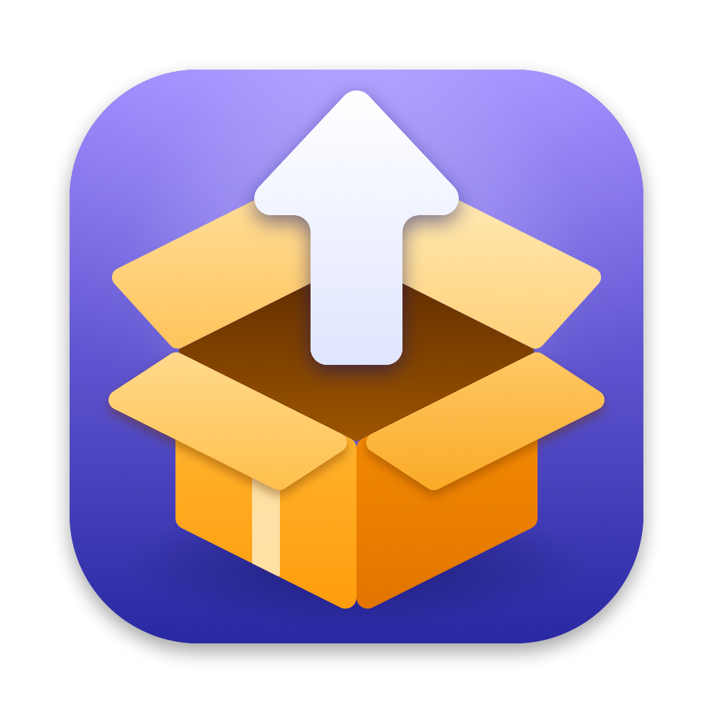

<p align="center">
  
</p>

<h1 align="center">Unpaxo</h1>

<p align="center">
  <b>macOS için sade, açık kaynak arşiv açıcı ve sıkıştırıcı.</b><br>
  Extract files. Simply.
</p>

<p align="center">
  
  
  
  <a href="LICENSE"></a>
</p>

<p align="center">
  <a href="#kurulum"><b>Kurulum</b></a>
  &nbsp;·&nbsp;
  <a href="#desteklenen-biçimler">Biçimler</a>
  &nbsp;·&nbsp;
  <a href="#kullanım">Kullanım</a>
  &nbsp;·&nbsp;
  <a href="#güvenlik-ve-gizlilik">Güvenlik ve gizlilik</a>
  &nbsp;·&nbsp;
  <a href="#kaynaktan-derleme">Derleme</a>
  &nbsp;·&nbsp;
  <a href="#english">English</a>
</p>

<p align="center">
  
</p>

## Neden Unpaxo?

- **Önce bak, sonra çıkar.** Arşivin içi diske hiçbir şey yazılmadan gösterilir; hepsini ya da yalnızca seçtiğin dosyaları çıkarırsın.
- **Dosyalarına dokunmaz.** Var olan hiçbir dosyanın üzerine yazmaz; ad doluysa "Ad 2" olarak kaydeder.
- **Derli toplu.** Tek dosya ya da klasör olduğu gibi çıkar; birden çok öğe arşivin adını taşıyan tek klasörde toplanır.
- **Sıkıştırır da.** ZIP (isteğe bağlı AES-256 şifreyle), 7Z ve TAR arşivleri oluşturur.
- **Gizli.** App Sandbox içinde çalışır, internete bağlanamaz; hesap, reklam ve izleme yoktur.
- **Ücretsiz ve açık kaynak.**

## Kurulum

Unpaxo, Mac App Store'da yayımlanmak üzere hazırlanıyor; bağlantı yayımlanınca buraya eklenecek.
O zamana kadar [kaynaktan derleyebilirsin](#kaynaktan-derleme).

Gereken: macOS 14 (Sonoma) ya da sonrası. Apple silicon ve Intel Mac'lerde çalışır.

## Desteklenen biçimler

| Biçim | Açma | Oluşturma | Not |
|---|:---:|:---:|---|
| ZIP | ✅ | ✅ | Şifreli arşivler (ZipCrypto ve AES); oluştururken AES-256 |
| RAR | ✅ | — | RAR4, RAR5, şifreli ve çok parçalı arşivler |
| 7Z | ✅ | ✅ | Şifreli 7Z henüz açılamıyor |
| TAR | ✅ | ✅ | |
| TAR.GZ / TGZ | ✅ | ✅ | |
| TAR.BZ2 | ✅ | ✅ | |
| TAR.XZ | ✅ | ✅ | |
| GZ, BZ2, XZ | ✅ | — | Tek dosyalık sıkıştırılmış veri |

RAR oluşturulamaz: RAR sıkıştırması lisans gereği yalnızca WinRAR'a aittir.

## Kullanım

**Arşiv açmak**

1. Arşivi Unpaxo penceresine sürükle, Finder'da çift tıkla ya da **Dosya › Arşiv Aç…** (Command-O) ile seç.
2. İçeriğe göz at. Klasörleri okla açıp kapatabilir, dosyaları Command ya da Shift ile çoklu seçebilirsin.
3. **Tümünü Çıkar** ya da **Seçilenleri Çıkar**.

Dosyalar arşivin bulunduğu klasöre çıkar. Birden çok arşivi birlikte bırakırsan hepsi sırayla çıkarılır.

**Arşiv oluşturmak**

1. Dosya ya da klasörleri pencereye sürükle ya da **Dosya › Yeni Arşiv…** (Command-N).
2. Biçimi seç; ZIP için istersen bir şifre yaz.
3. **Sıkıştır…** ile arşivin kaydedileceği yeri seç.

**Ayarlar** (Command-virgül): dil (Sistem, Türkçe, English), her seferinde klasör sorma, Finder'dan açılan arşivi hemen çıkarma, iş bitince sonucu Finder'da gösterme.

<p align="center">
  
  
</p>

## Güvenlik ve gizlilik

- **App Sandbox:** İzinler [`Support/Unpaxo.entitlements`](Support/Unpaxo.entitlements) dosyasında. **Ağ izni yoktur**; macOS, Unpaxo'nun internete bağlanmasını engeller.
- **Dosya erişimi:** Yalnızca açtığın, sürüklediğin ya da seçtiğin dosyalar ve İndirilenler klasörü. Başka bir klasöre ilk çıkarmada macOS'un klasör seçme penceresiyle bir kez onay istenir; o klasör için bir daha sorulmaz.
- **Kötü niyetli arşivler:** `..` ya da mutlak yol içeren, hedef klasörün dışına yazmaya çalışan öğeler çıkarılmaz. Simgesel bağların üzerinden yazılmaz. Sahiplik ve özel izin bitleri arşivden alınmaz.
- **Şifreler:** Yalnızca işlem sırasında bellekte tutulur, diske kaydedilmez.
- **Veri toplama yok:** Ayrıntılar [PRIVACY.md](PRIVACY.md), açık bildirimi [SECURITY.md](SECURITY.md).

## Kaynaktan derleme

Gerekenler: Xcode 16 ya da sonrası (komut satırı araçlarıyla).

```bash
git clone https://github.com/mugione/Unpaxo.git
cd Unpaxo
./Vendor/build-deps.sh   # libarchive, xz ve UnRAR'ı indirir, özetlerini doğrular ve derler (bir kez)
swift test               # motor testleri
./build.sh --open        # build/Unpaxo.app oluşturur ve açar
```

Proje düzeni:

| Yol | İçerik |
|---|---|
| `Sources/UnpaxoCore` | Arşiv motoru: okuma, çıkarma, sıkıştırma, yerelleştirme |
| `Sources/Unpaxo` | SwiftUI arayüzü |
| `Sources/CArchiveLibs` | C kütüphanelerinin başlıkları ve UnRAR sarmalayıcısı |
| `Vendor/build-deps.sh` | Üçüncü taraf kütüphaneleri kaynaktan derler |
| `Support` | Info.plist, yetkiler, simge ve görsel üretme betikleri |
| `Tests` | Uçtan uca testler ve örnek RAR dosyaları |

Türkçe metinler kodun içindedir; İngilizce karşılıkları `Sources/UnpaxoCore/English.swift` sözlüğündedir.

## Teşekkür

Unpaxo şu açık kaynak kütüphaneleri kullanır: [libarchive](https://www.libarchive.org) (BSD),
[XZ Utils](https://tukaani.org/xz/) (0BSD) ve [UnRAR](https://www.rarlab.com) (UnRAR lisansı, yalnızca çıkarma).

## Lisans

[MIT](LICENSE). Üçüncü taraf kütüphaneler kendi lisanslarına tabidir.

---

## English

**Unpaxo** is a simple, open-source archive extractor and creator for macOS.

- **Look first, then extract.** See what is inside before anything is written to disk; extract everything or only the files you pick.
- **Careful with your files.** Never overwrites; a taken name becomes "Name 2". Several items go into one tidy folder.
- **Opens** ZIP, RAR (RAR4, RAR5, encrypted, multi-part), 7Z, TAR, TAR.GZ, TAR.BZ2, TAR.XZ, GZ, BZ2 and XZ.
- **Creates** ZIP (optional AES-256 password), 7Z, TAR, TAR.GZ, TAR.BZ2 and TAR.XZ. RAR cannot be created because of the RAR licence; encrypted 7Z is not supported yet.
- **Private.** Sandboxed, with no network entitlement: no accounts, ads, analytics or tracking. See [PRIVACY.md](PRIVACY.md).
- **Free**, in English and Turkish, for Apple silicon and Intel Macs on macOS 14 or later.

**Install:** a Mac App Store release is in preparation. Until then, build from source:

```bash
git clone https://github.com/mugione/Unpaxo.git
cd Unpaxo
./Vendor/build-deps.sh
./build.sh --open
```

**Use:** drop an archive on the window (or double-click it in Finder), then choose Extract All or Extract Selected. Drop files or folders to compress them.

Licensed under [MIT](LICENSE). Bundled libraries: libarchive (BSD), XZ Utils (0BSD), UnRAR (UnRAR licence, extraction only).
